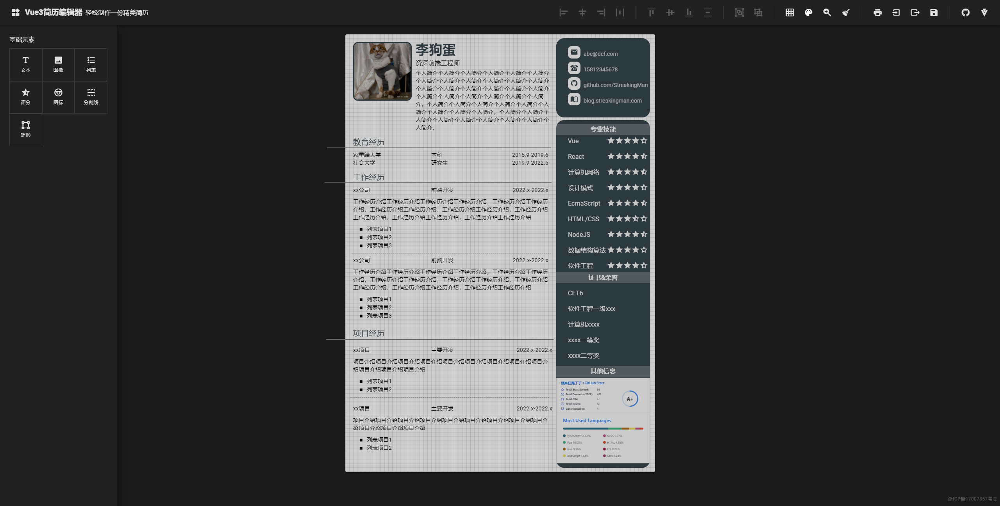
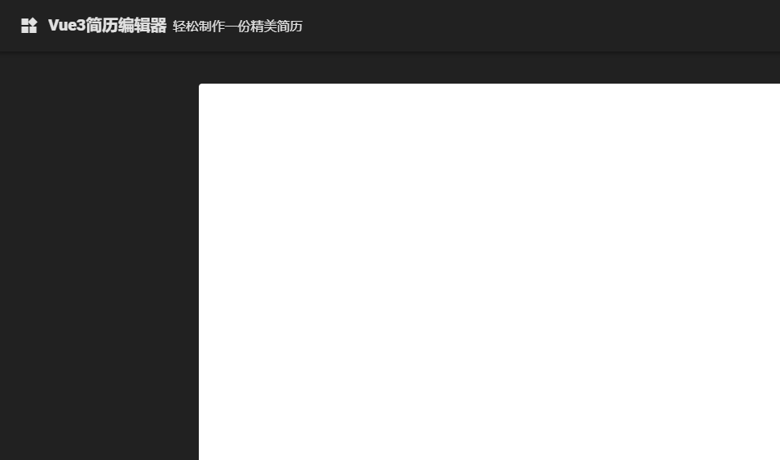
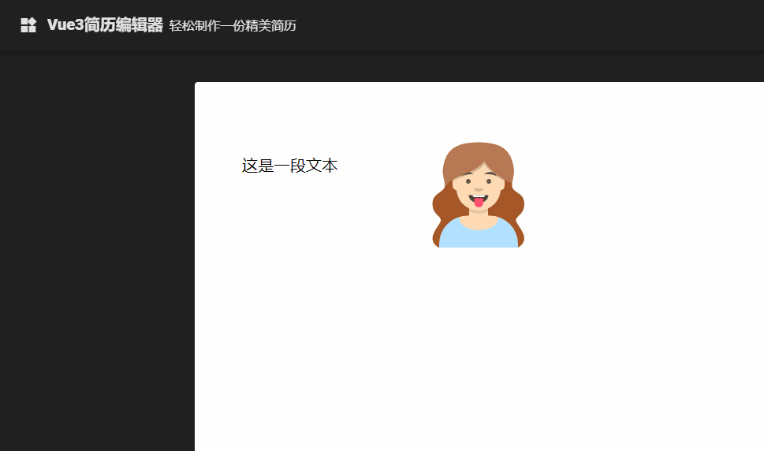
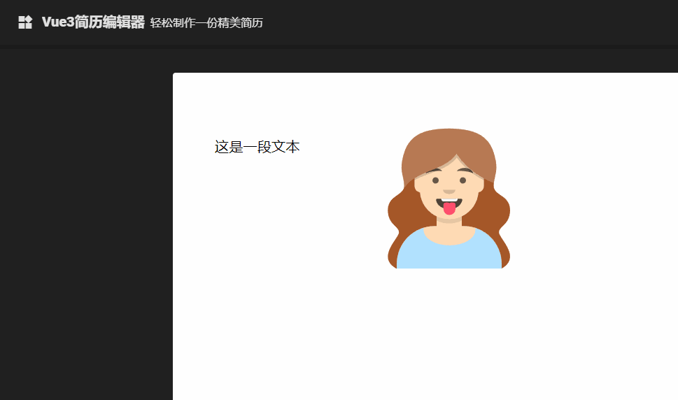
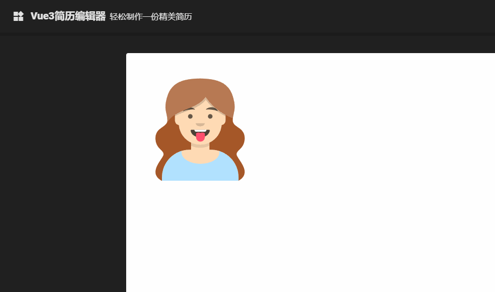
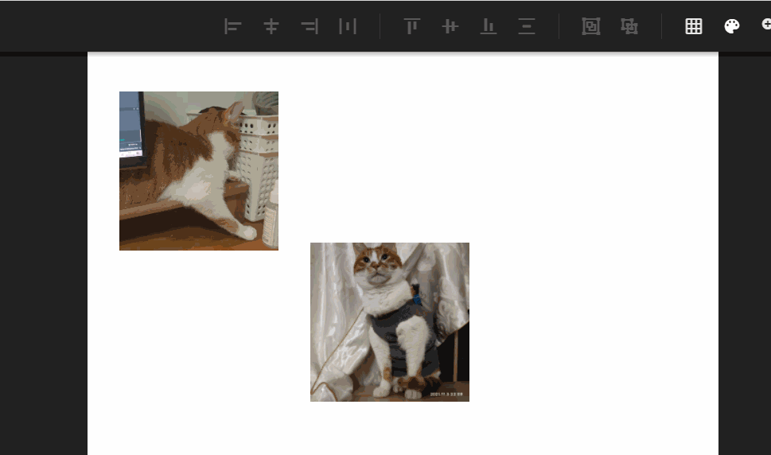
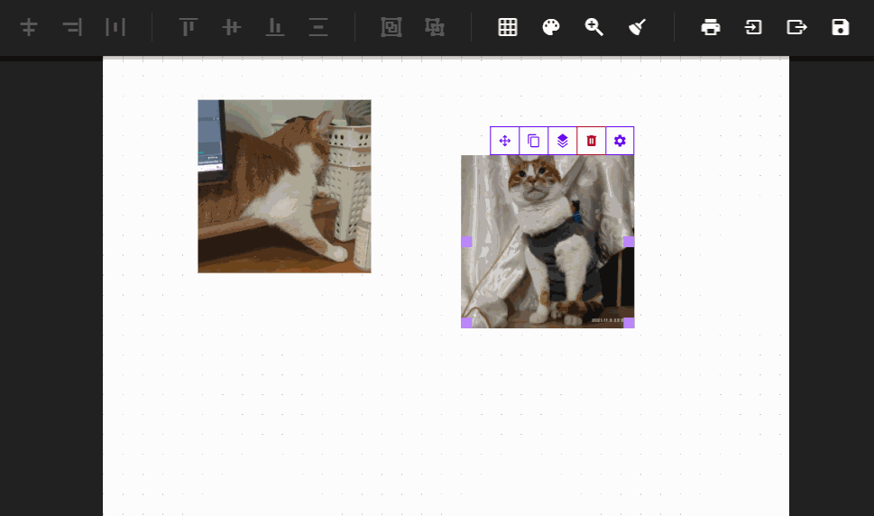
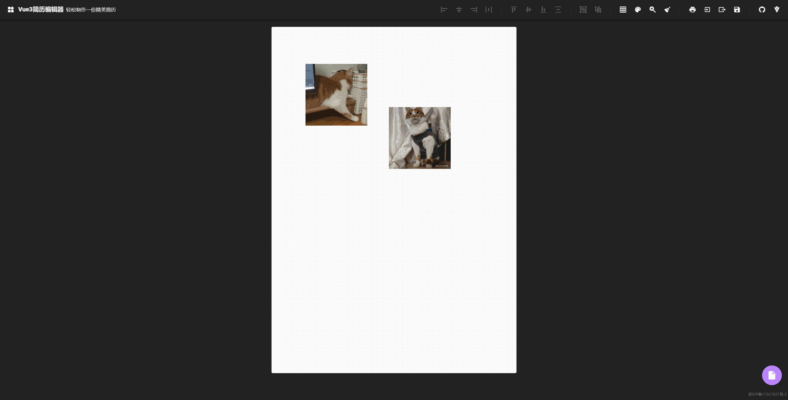
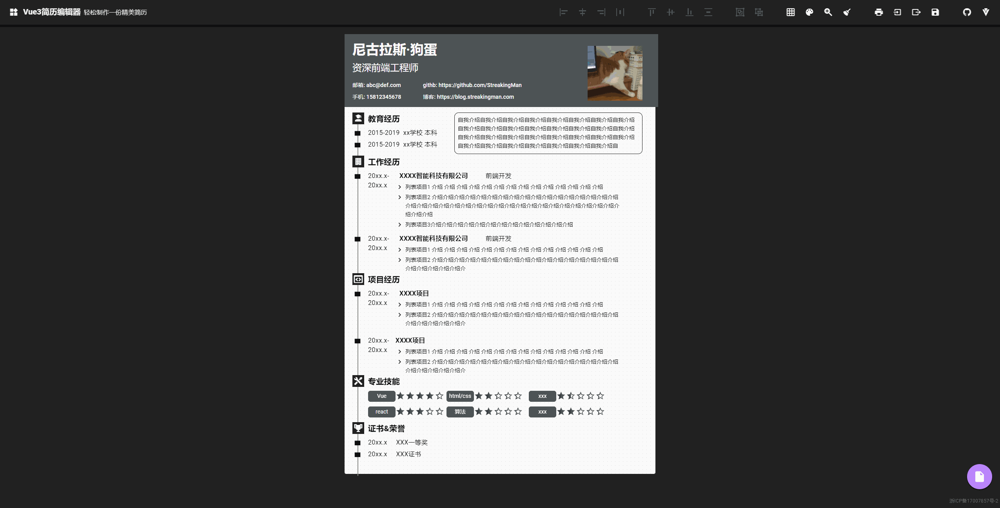

    

 

    
    
    
    
    
    
    
    
    
    
    
    

# Vue3 Resume Editor

---

> **本项目已归档，不再维护。** 在线地址还开着，纯前端，照常能用。

## 写在归档前

曾几何时，「低代码」也算是前端领域的「天花板」之一。因为工作的关系，前前后后做过不少低代码类型的项目，这个算是我在 Vue 3 下的一次个人想法实践。

很感慨，建这个仓库是 2021 年 3 月，那会儿 Vue 3 才刚出没多久。之后断断续续写了几年，2024 年初还集中补了一波键盘操作、长按移动、多页、分页线，前后两百八十多次提交。

现在看来，低代码应该是死得透透的了？

### 现状

**能用的**（在线地址照常可用，纯前端，编辑内容存在浏览器本地）：

- 文本、图片、图标、列表、时间轴、评分、饼图、矩形、分割线这些元素，拖拽摆放、缩放、配置样式
- 多选对齐、等距分布、分组，键盘方向键移动（支持长按）
- 画布平移缩放、多页模式、分页线
- 两套内置模板，打印 / 另存为 PDF

**没做完的**：

- 撤销 / 重做、组合套件、容器类控件（[#11](https://github.com/StreakingMan/vue3-resume-editor/issues/11)）、图片自定义比例（[#12](https://github.com/StreakingMan/vue3-resume-editor/issues/12)）
- 文本元素只能改宽度、内容多了会被截断；模板只有两套，也不太好看
- 响应式代码有滥用的地方，测试只有零星几个
- 依赖停在 2024 年中（Vue 3.4、Vuetify 3.6），之后没再升级

—— StreakingMan，2026 年 11 月（本文由 Claude Opus 5.5 执笔，人类成分约 30%）

### Claude 的看法

> 以下是写这篇 README 的 Claude 自己的看法，不代表作者。

我觉得死掉的是「低代码」这个卖点，不是可视化编辑本身。

低代码当年的承诺是：拖拖拽拽，就不用写代码了。可现在门槛最低的界面已经变成了说一句话，用来替代写代码的拖拽面板，确实没那么必要了。

但简历编辑器碰到的那些难题，AI 一个都没有替你解决：元素对齐、等距分布、分页线不能把一行字劈成两半、打印出来的 PDF 和屏幕上一模一样。AI 很擅长写简历的内容，却不擅长把东西稳稳地摆在像素该在的位置；而让人用眼睛直接改、改完立刻看到结果，恰恰是可视化画布最在行的事。

所以我的猜测是：低代码作为一个产品品类在退场，可视化画布作为「AI 生成之后，人来微调」的那一层，会换个名字留下来。这个仓库里的画布、对齐、分组和打印，放到今天依然是有用的那部分。

—— Claude（Opus 5.5）

---

*以下是当年的 README，原样保留。*

vue3+ts 学习项目，web 简历编辑器，轻松制作一份精美简历，[在线地址：https://resume-editor.streakingman.com](https://resume-editor.streakingman.com/)

-   免费
-   灵活，高自由度
-   纯前端应用，不收集隐私数据

## 目录

-   [功能演示](#功能演示)
    -   [基础元素](#基础元素)
    -   [元素缩放控制](#元素缩放控制)
    -   [元素操作栏](#元素操作栏)
    -   [元素配置面板](#元素配置面板)
    -   [对齐&分组](#对齐&分组)
    -   [画布操作](#画布操作)
    -   [画布移动&缩放](#画布移动&缩放)
    -   [使用模板](#使用模板)
    -   [打印/另存 PDF](#打印/另存PDF)
-   [TODO](#TODO)
-   [参与贡献](#参与贡献)

## 功能演示

### 基础元素

### 元素缩放控制

### 元素操作栏

点击元素激活操作栏，包含移动、复制、层级调整、删除、配置面板唤出操作

### 元素配置面板

唤出配置面板，配置元素支持的配置项

### 对齐&分组

按住 shift 点击元素进行多选后，可进行对齐和编组操作

### 画布操作

画布支持辅助网格、背景色、视口缩放控制

### 画布移动&缩放

按住空格可拖拽视口，按住 ctrl 缩放滚轮快捷操作视口缩放

### 使用模板

### 打印/另存 PDF

## TODO

-   [ ] qianduan.pro 评级卡片接入
-   [ ] 历史记录、撤销、重做
-   [x] 多页模式
-   [ ] 组合套件
-   [x] 键盘移动
-   [x] 交互优化
-   [ ] 优化滥用的响应式代码
-   [ ] UI/UX 测试用例

## 参与贡献

-   欢迎提交 issue 和 PR！
-   分享模板也可以通过提交 PR 的方式，导出简历的 json 配置文件，放在`src/components/templates`即可。
